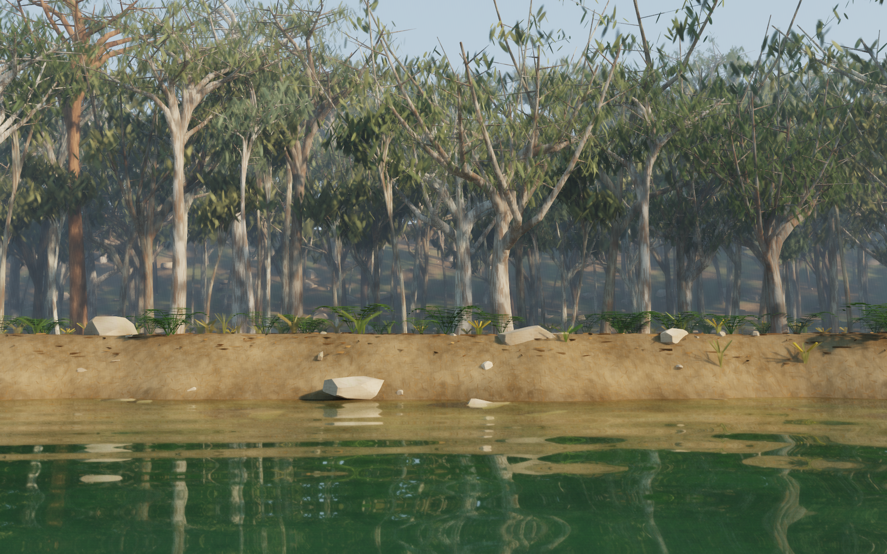

# Secret River

[Play the game](https://samg-coder.github.io/ForestSideScroll/) · [Build and deploy](https://github.com/SamG-Coder/ForestSideScroll/actions/workflows/pages.yml) · [MIT license](LICENSE)



A playable Australian riverbank game built with the CUDA WebShader pipeline. The presentation remains a fixed, low, side-on camera: river in front, an unoccupied bank, and forest behind. The camera follows the bank horizontally; there is no orbit or first-person camera.

## Run

Double-click `START.bat`, or run `npm start` and open **http://127.0.0.1:4327**. Node.js 20+ and a browser with WebGPU are required. The generated GPU programs are included; running the game does not require an npm install or the CUDA Toolkit.

The local server listens only on `127.0.0.1`. Opening `index.html` with a file URL cannot run WebGPU.

## Play

| Input | Action |
|---|---|
| A / D or left / right | Explore along the bank |
| W / S or up / down | Move inland / toward the water within the bank |
| Shift | Move faster |
| E / Enter | Cross between locations when the survey is complete |
| P | Freeze movement, foliage, water and the day clock; accumulate a refined still, then reuse it after 128 samples |
| Escape | Return to the menu / resume |

The journey retains the original **Wisemans Ferry / Broad Reach** and **Macdonald River / First Branch** locations, their authored shoreline knots, movement bounds, spawn coordinates, objective positions and gated return journey. Survey Broad Reach, continue east, trace First Branch, then return west. Riverbank Demo provides unguided exploration. There is no visible person, actor geometry, actor shadow, or actor reflection. Journey progress saves locally and survives reloads and menu visits.

The view settings select 768, 960, 1280 or 1920 internal pixels across; 2, 4 or 6 light bounces; time of day; and exposure. Save image exports the rendered pixels at the selected internal resolution. It excludes the HTML interface. Ultra is intended primarily for still views on this implementation.

**Oil painting** is an optional View settings effect, with a 0–100% Paint strength slider. It covers the entire scene: foliage, trunks, rocks, soil, sky, water and reflections. The toggle, strength and per-layer depths are remembered locally, including toggle/strength preferences saved under the former foliage-only option. It defaults to off on a fresh installation.

The effect is authored in `src/paint.cu` and replaces the final tone-map/pixel-pack kernel after denoising and temporal antialiasing. Paint is evaluated in this order, while retaining the scene's actual geometry and occlusion:

| Layer | Default depth | Brush character |
|---|---:|---|
| Trees and dirt | 70% | Broader background strokes; sky uses this depth with lighter bristle texture |
| Rocks | 50% | Flatter strokes that follow the appearance of rock facets |
| Leaves and ferns | 35% | Finer dabs for foliage, grass and fern detail |
| Water | 60% | Horizontal strokes over the completed water/reflection image |

Each depth changes that layer's stroke reach and paint amount. Zero leaves the layer's unpainted detail; the main strength slider scales all layers. Neighbour samples are weighted by their coverage of the same material layer. The four-channel coverage image accumulates with the colour image, including bilinear reprojection when the camera moves, so painting does not switch masks each time a jittered ray alternates between a leaf and the sky behind it. Region selection and pigment transitions are continuous. Changing strength or any layer depth does not reset accumulation. A converged still only reruns the final resolve, and Save image includes the chosen look. Switching the effect off, setting strength to zero, or setting all layer depths to zero restores the unpainted image exactly.

Foliage antialiasing works independently of the paint option. The previous renderer discarded lighting history whenever a primary ray hit a different leaf or fern leaflet, and only spatially filtered a primitive against itself. The spatial filter now shares samples among nearby foliage of the same material, with depth, normal and colour weights. The second existing filter pass also accumulates pixel coverage separately from surface lighting, so subpixel gaps no longer discard the whole displayed pixel. Static views accumulate up to 128 coverage samples; live views retain up to 12, water up to 6, and moving views up to 8. Camera movement uses bilinear reprojection, depth/normal rejection and neighbourhood clipping. Resizing, changing locations or lighting, and other renderer resets clear this history.

Stabilization and layer coverage add three full-resolution float4 image buffers in total (26.4 MiB at 960 x 600), with no extra GPU dispatch or lighting rays. Wind animation and primary-ray antialiasing remain active.

## Procedural scene

All geometry, terrain, surface patterns, animation, game simulation, ray intersections, lighting, accumulation, filtering and final pixel packing are authored in `src/*.cu`. JavaScript manages browser input, user interface, buffer lifetime, dispatch order, saved state and presentation. No Three.js, imported meshes, photographic textures or generated image assets are used by the running game.

Each location contains 640 seeded trees, represented together with undergrowth and rocks by 524,288 analytic primitives:

- 128 more detailed foreground and middle-distance trees, with tapered wood segments, individual narrow leaves, mottled bark and procedural veins.
- 512 additional background trees in eight depth rows, with overlapping crowns and many visible trunks. Their distant foliage uses larger primitives to retain coverage.
- Four growth architectures: tall smooth-barked gums, old spreading gums, narrow younger gums, and forked dark-barked trees. Seeded variation changes trunk lean, height, radius, forks, limb angles, crown width, colour and leaf distribution.
- 256 fern clumps with 1,536 arched fronds and 30,720 individual paired leaflets, with narrow and broad pinna forms, varied height, spread, colour and placement. Reeds, strappy grasses, seed heads and fallen gum leaves add ground-cover variation.
- 2,048 sandstone volumes in four shape families: thin bedding slabs, tapered wedges, fractured blocks and long splinters. Each has 104 cached cutting planes, unequal ends, seeded fracture cuts and flat face normals. Their lower portions sit within the bank. Wet edges, strata, mineral grain and lichen provide finer surface detail.
- Separate 2048 x 2048 CUDA-generated soil and sandstone material maps, including height detail and 12 mip levels. They are generated once and sampled with distance filtering; no texture images are downloaded.
- A continuous riverbed with irregular shelves, sandbars and deeper scour pockets. A 4096 x 2048 cached height field resolves the bank at approximately 7 cm spacing; finer material relief is shaded separately.

The scene has a CUDA-built binary bounding-volume hierarchy. Morton ordering groups nearby primitives before construction, making ray traversal substantially cheaper than grouping entire trees by generation order. Ray transforms and branch axes are prepared once with the geometry; leaf and fern poses update once per changed wind time. Leaves sway within conservative bounds without rebuilding the static hierarchy. All location geometry is regenerated on the GPU when crossing to the other bank. Rock fracture planes are also generated once per scene, rather than inside ray intersections.

## Rendering

`tracePaths` traces stochastic surface paths with cosine-weighted diffuse bounces, sampled sun/moon visibility, thin-leaf diffuse transmission, and Fresnel reflection/refraction with absorption in the river. Animated analytic normals create water ripples. Temporal reprojection and normal/depth/albedo-aware spatial filtering reduce noise. Pausing allows longer accumulation. Near the wet margin, grazing reflections fade with the local depth; refraction follows the actual bed geometry, with Beer-Lambert absorption and an approximate scattering term over the underwater path. Shallows reveal sand and submerged stones, while deeper areas become greener and less transparent.

This is a compute path tracer through CUDA-to-WGSL-to-WebGPU. It does not use native CUDA execution or hardware RTX ray-query extensions. Aerial haze is a distance approximation, the river is a planar interface with animated normals, and the solar highlight on water is approximated. It does not simulate volumetric multiple scattering, geometric breaking waves, spectral transport or caustic focusing. The original geographic mini-map and painted character atlas are not included; the recreated game uses a progress HUD and an unobstructed landscape view.

## Source

| File | Responsibility |
|---|---|
| `src/common.cu` | Math, deterministic noise, original location profiles, ground, sky and wind |
| `src/game.cu` | Movement, boundaries, clock, objectives and location transitions |
| `src/generate.cu` | Tree architectures, background forest, ferns, ground cover, rocks and spatial BVH construction |
| `src/materials.cu` | Cached terrain heights, 2K material generation, mipmaps and filtered sampling |
| `src/trace.cu` | Analytic intersections, hierarchy traversal and procedural surfaces |
| `src/render.cu` | Path tracing, temporal accumulation, filtering and output pixels |
| `src/paint.cu` | Material-layer oil painting with independent paint depths in the final image resolve |
| `src/gpu.js` | Runtime setup, buffers, kernel dispatch and GPU-to-canvas presentation |
| `src/main.js` | Input, HUD, settings, local saves and diagnostic hooks |

The original game is read-only source material; this project does not modify it. `references/` contains comparison images and is not loaded by the game.

The vendored compiler/runtime comes from `D:/cuda-webshader`, revision `ef46ff1bf02a306bad94ddc18286d25d3d902c14`. Its MIT license is retained in `vendor/cuda-webshader/LICENSE`. Only its runtime dependency graph and compiler are bundled; its unrelated Three.js bridge and sample tools are omitted.

## Build and verification

```sh
npm run build
npm install --ignore-scripts
# Keep npm start running in another terminal:
npm test
npm run test:paint
npm run test:temporal
```

The build needs no npm packages. The test uses Playwright with installed Edge; set `CW_BROWSER` to another installed Playwright browser channel if required. Tests compare the combined CUDA source and the disk/served shaders against the build manifest before launching the game.

`artifacts/scene-paint-validation.json` records the painting checks: every visible material group is affected, each layer depth only changes pixels covered by that layer, valid stable coverage weights, unchanged HDR lighting/geometry, exact restoration at zero/off, no repeated passes for a settled painted still, both locations and partial workgroups, painted PNG export, and persistence of the toggle, strength and four layer depths. GPU timestamps in the report measure 16 warmed paint-and-resolve passes at 960 x 600 and exclude compilation, simulation and presentation. Before/after captures are `artifacts/scene-paint-before.png` and `artifacts/scene-paint-after.png`.

`artifacts/before-jitter.json` and `artifacts/after-jitter.json` compare the same seeded 960 x 600 sequences: 32 measured frames after 32 warmup frames, with painting disabled, first with fixed wind, then animated wind, then camera movement. The separate painted sequence checks that the effect preserves the stabilization. Controlled GPU inputs test reset behavior, rejection of newly exposed surfaces, clipping of stale bright history and a partial workgroup. Moving-frame differences include genuine scene motion and are not a pure noise metric.

At a fixed camera with animated wind and painting **disabled**, mean frame-to-frame RGB changes fell as follows (8-bit channel values):

| Material | Before | After | Reduction |
|---|---:|---:|---:|
| Gum leaves | 29.90 | 1.61 | 94.6% |
| Grass and reeds | 36.21 | 1.85 | 94.9% |
| Fern leaflets | 32.61 | 1.95 | 94.0% |

These measure stability of the displayed image, not an increase in rendering FPS. The layered paint-and-resolve kernel measured **0.190 ms median / 0.196 ms p95** over 16 warmed GPU timestamp samples at 960 x 600 on the local RTX 5080. This excludes compilation and presentation. The antialiasing history has a deliberate smoothing/detail tradeoff during motion; camera reprojection, history rejection and clipping limit trailing when new surfaces appear.

`artifacts/validation.json` records 20 passing checks covering actual keyboard input, finite geometry, positive radii, hierarchy containment and sorted primitive coverage, deterministic/different seeds, person removal, fern geometry, shallow/deep riverbed variation, four rock families and their cached planes, both surveys, the complete out-and-back journey, bank limits, pause behavior, save/reload, menu continuation, quality changes, PNG download, day/night rendering, and a light-transport negative control. Additional bounces increase reflected/refracted river radiance. The geometry oracle compares cached and uncached ray transforms at wind times 0, 0.73 and 5.8 seconds, across both locations and an image height with a partial workgroup. It checks output pixels, hit identity, hit position and HDR radiance separately.

Lighting and cache checks compare the same camera, light, random sample sequence and resolution with reuse enabled and disabled. The measured average RGB difference is **0.790 / 255**, with **1.866 / 255 RMS**. The cache only reuses matching primitive IDs, positions and normals; a result expires after one frame. Water always traces fresh paths. Lighting changes invalidate accumulated lighting without regenerating terrain or materials. The test also proves that a converged still keeps identical pixels while submitting no new path-tracing work, exposure changes only resolve existing radiance, and changing the hour resumes tracing.

### Rock and geometry-cache optimization

`artifacts/rock-revision-comparison.json` preserves the rock-revision comparison against uncached transform construction with the same new rock shapes, camera, wind, materials, four bounces and 960 x 600 pixels. Both variants use cached rock planes and the original filter. The reference uses 8 x 8 trace workgroups and repeats the original child-bounds test; production uses spatially packed transforms, avoids that redundant test and uses 8 x 4 trace workgroups. Both kernels compile from the CUDA source, with per-entry hashes in the manifest. The reference pipeline loads only when diagnostics request it.

Measurements from that rock-revision comparison on the RTX 5080 in headless Edge:

| Measurement | Reference | Optimized |
|---|---:|---:|
| Interleaved full-render median, 64 samples each | 58.37 ms | 57.12 ms |
| Interleaved full-render p95 | 66.51 ms | 64.19 ms |
| GPU ray-tracing median, 16 identical sample indices each | 50.59 ms | 48.76 ms |

The interleaved run alternates which variant renders first, using identical random sample indices within each pair. Separate warmed ABBA batches gave reference medians of 52.14 / 53.87 ms and optimized medians of 52.17 / 51.26 ms. This is a modest improvement: approximately 2% in the interleaved full-render median and 4% in the GPU tracing pass. System-load variation is material; initial, less stable results were larger and should not be treated as a sustained speedup. Queue timings include submission through completion and exclude simulation, animation-frame waiting and browser composition.

The final oracle found zero differing pixels, primitive IDs, positions or HDR radiance values in all four scene/time cases, each with 371,712 pixels. `artifacts/rock-revision-profile.json` records those GPU pass timings: tracing accounts for about 96% of measured compute time, while the two spatial filters together take about 1.94 ms. The next substantial savings would have to address ray traversal/intersection cost. Adding more lighting-cache passes is unlikely to help as much.

`node scripts/optimize.mjs` reruns the warmed batches, interleaved pairs and image oracle, then captures the new rock shapes. `node scripts/tune-workgroups.mjs` checks workgroup variants against identical output hashes. The rejected tiled filter is documented in `artifacts/rejected-tiled-profile.json`; its extra shared-memory work did not improve this scene and is absent from the final renderer.

Historical measurements from the preceding bank/fern revision, in headless Edge on the reported NVIDIA Blackwell adapter, four bounces and 20 warm measured passes per size. These were recorded in an earlier session and are not the current optimization comparison:

| Internal size | Previous median | Revised median | Revised p95 |
|---|---:|---:|---:|
| 768 x 480 | 31.00 ms | 22.00 ms | 24.95 ms |
| 960 x 600 | 47.04 ms | 33.04 ms | 35.03 ms |
| 1280 x 800 | 80.43 ms | 55.21 ms | 59.24 ms |

The table measures full fresh samples in a frozen view, before reaching the 128-sample limit. These times include command submission through GPU completion, and exclude simulation, animation-frame waiting and browser composition. The live movement test measured **32.66 ms median / 33.56 ms p95** for simulation plus rendering at 960 x 600, also excluding animation-frame idle gaps. This is about 30% less render time than the previous dense forest, with more detailed ground cover and materials; it is not a claim of compositor frame rate.

`artifacts/before-bank-profile.json` and `after-bank-profile.json` separately record GPU timestamp measurements per kernel. `artifacts/bank-inspection.json` compares the revised scene with and without recent-lighting reuse. Most of the overall speedup comes from spatial ray traversal and avoiding low-contribution path work. Recent-lighting reuse provides a smaller additional saving. The terrain/material caches add about 79 MiB of persistent GPU data including sort keys; they avoid recomputing geometry and fine procedural material noise inside every ray.

The renderer now:

- Builds geometry, spatial ordering and the BVH when the seed/location changes; material maps are created once.
- Caches ray transforms and rock cutting planes in 35.25 MiB of additional GPU storage. Ray records follow the BVH's Morton ordering, keeping spatial neighbours together in memory. Only animated leaf positions update during motion; stationary views and light-only changes do not rebuild these caches. Terrain depends on location, so changing a forest seed does not rebake it.
- Avoids retesting a BVH child immediately after selecting it. Deferred nodes still retest against the current nearest hit. Shadow rays skip surface normals and terrain refinement once an occluder is found.
- Traces in 8 x 4 workgroups, with the original normal/depth/albedo-aware noise filter. A shared-memory tiled filter was tested but removed because its extra work did not improve GPU timings on this scene.
- Bounds ray traversal by the closest water interface, and exits rock clipping tests once a miss is known.
- Uses unbiased Russian roulette after the second surface interaction to reduce low-energy path work.
- Reuses a subset of validated opaque-surface lighting for at most one frame while moving, with freshly traced disocclusions and animated water.
- Stops all path tracing and filtering after 128 stationary samples. Exposure can still change without retracing.
- Skips simulation dispatch/readback when already paused with unchanged state.

## Visual iteration record

1. Initial procedural view established the side camera, walker and traced river. Review found regular branching, overly smooth rocks and bare ground.
2. Added tapered and forked wood, bark variation, leaf veins, sandstone facets, ground litter and albedo-guided filtering. Inspected 1920-wide stills, sunset and night.
3. User reference exposed the missing dense background and insufficient gum-tree variation. Added 512 background trees, four growth architectures, taller pale trunks, narrower pendant leaves and smoother branch junctions. Retained the user's two supplied reference images.
4. Corrected grazing terrain rays that exhausted their traversal budget near flat bank sections, added leaf sway and night key light, rebuilt all CUDA kernels, and reran the full browser checks.

5. Removed the person, generated curved fern fronds and mixed ground cover, raised sandstone shape detail, and baked 2K material maps. Added irregular underwater shelves and depth-dependent clarity. The first iteration overpopulated the bank with rocks; reduced their density and material contrast after inspecting the render.
6. Profiled the GPU passes, added spatial primitive ordering, cached terrain/material data and recent surface lighting, and stopped converged still rendering. Compared reuse against fresh tracing, inspected both banks and reran all 18 checks.
7. Replaced rounded rock forms with slabs, wedges, fractured blocks and splinters, using cached fracture planes and flat face normals. Lowered the broad slabs into the bank after inspecting their contact with the sloping ground.
8. Cached ray transforms and wind poses, skipped redundant bounds checks and shadow-only normal/refinement work, and tested seven trace workgroup shapes with identical output hashes. Selected 8 x 4. Removed a four-way traversal experiment after it ran slower and changed edge hits; also removed a tiled filter after GPU profiling showed no benefit. Both experiments were excluded from the final renderer.

Current captures are `artifacts/broad-reach.png`, `first-branch.png`, `sunset.png` and `night.png`. The first two use 96 accumulated passes at 1920 × 1200, displayed in a 1440 × 900 browser capture. `before-background-revision.png` retains the earlier sparse forest for comparison. Visual fidelity is a procedural recreation, not an exact match to the painted original; foliage silhouettes, fern pinnae and terrain shading remain procedural approximations. `broad-reach-canvas.png` contains the 1920-wide render without the HTML interface, and `before-bank-update.png` retains the previous scene for comparison.

## GitHub Pages and license

The public demo is https://samg-coder.github.io/ForestSideScroll/. The Pages workflow checks JavaScript syntax, rebuilds the CUDA shaders, verifies generated hashes and packages the static site. Pushes to `main` deploy automatically; pull requests run the build checks without deploying. Run `npm run build:pages` locally to prepare `dist/`. A WebGPU-capable browser and GPU are required to play. Hosted CI validates the build and package; the GPU gameplay, image and timing checks run separately on a local GPU.

The project is licensed under [MIT](LICENSE). The vendored CUDA WebShader compiler/runtime retains its own [MIT notice](vendor/cuda-webshader/LICENSE) and provenance. Local reference images, working backups and intermediate captures are excluded from publication; selected validation reports and the screenshot above are included.
